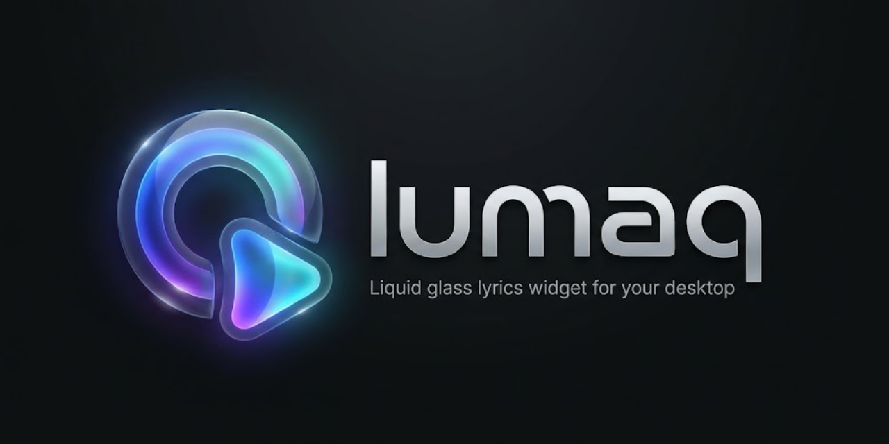

<p align="center">
  
</p>

# Lumaq 🎵🪟

**Lumaq** is a lightweight, zero-login desktop widget for Windows that brings your currently playing music to life in an elegant, translucent liquid-glass card. It displays dynamic album art, time-synced lyrics with fluid two-line transitions, a progress bar with millisecond-smooth interpolation, and full media playback controls.

---

## ✨ Features

- **Liquid Glass Aesthetic:** Apple iOS/visionOS-inspired frosted glass styling with dynamic specular rim highlights, edge refraction, and background album-art crossfade.
- **Zero Login / Zero API Keys:** Seamlessly hooks into the native Windows Global System Media Transport Controls (GSMTC) session. Works automatically with Spotify desktop, Apple Music, Tidal, Chrome/Edge media, and any GSMTC-compatible player.
- **Time-Synced Lyrics:** Live 2-line lyric tracking powered by [LRCLIB](https://lrclib.net). Active line shines bright and italicized; the upcoming line gently previews below.
- **Fluid Playback Controls:** Play/pause, next, previous, shuffle, repeat, and click-to-seek progress bar with animated thumb.
- **Smart Edge Snapping & Lock:** Move the widget anywhere or lock it in place; snaps cleanly to screen edges.
- **Click-Through Mode:** Pass all mouse events directly through to windows underneath (toggle or recover at any time via the System Tray menu).
- **Offline & Robust:** In-memory + on-disk LRU caching of lyrics with negative caching (24h) and positive caching (30d). Never crashes on offline tracks or missing lyrics.
- **Privacy & Security First:** Zero frontend internet access (`connect-src 'none'`). All networking is isolated to the Rust backend with strict Content Security Policy.

---

## 🛠️ Architecture & Tech Stack

- **Shell:** [Tauri 2](https://v2.tauri.app/) (Rust backend + WebView2 frontend)
- **Frontend:** React 18, TypeScript, Vite, Pure CSS (CSS variables, backdrop-filter, SVG refraction). Bundled fonts via `@fontsource/inter` (no remote CDN).
- **Windows Integration:** `windows` crate (WinRT `GlobalSystemMediaTransportControlsSessionManager`), asynchronous multi-channel architecture with dedicated native GSMTC thread.
- **Lyrics Provider:** [LRCLIB](https://lrclib.net) with automatic title/artist normalization and fallback search.

For deep architectural details, see [ARCHITECTURE.md](docs/ARCHITECTURE.md).

---

## 🚀 Getting Started

### Prerequisites

- **OS:** Windows 10 (1809+) or Windows 11.
- **Media Player:** Spotify Desktop App (recommended) or any media player supporting Windows GSMTC.
- **Dev Toolchain (for building from source):**
  - [Node.js](https://nodejs.org/) (v18+)
  - [Rust](https://rustup.rs/) (stable channel, `x86_64-pc-windows-gnu` or `x86_64-pc-windows-msvc`)

### Running in Development

1. Clone the repository:
   ```bash
   git clone https://github.com/your-username/lumaq.git
   cd lumaq
   ```

2. Install frontend dependencies:
   ```bash
   npm install
   ```

3. Launch Lumaq in development mode:
   ```bash
   npm run tauri dev
   ```

### Running Tests

- **Rust Backend:**
  ```bash
  cargo test --manifest-path src-tauri/Cargo.toml
  ```
- **Frontend:**
  ```bash
  npm test
  ```

---

## ⚙️ Configuration & System Tray

Right-click the Lumaq card or use the **System Tray icon** in your taskbar to open settings:
- **Show / Hide Widget**
- **Lock Position:** Disables window dragging.
- **Click-Through:** Allows clicks to pass through to windows behind Lumaq. (Recover by right-clicking the tray icon and deselecting Click-through).
- **Always on Top:** Keeps the widget floating above other windows.
- **Source Preference:** Set to "Spotify First" (default) or "Any Active Player".
- **Lyrics Offset:** Fine-tune lyric synchronization in milliseconds (+/- ms).

---

## ⚖️ Disclaimers & Licensing

- **Disclaimer:** Lumaq is an unofficial open-source utility and is not affiliated, endorsed, or associated with Spotify AB or any media streaming service.
- **Lyrics:** Synced and plain lyrics are provided by the community through [LRCLIB](https://lrclib.net). No copyrighted lyrics are bundled with this application.
- **License:** Released under the [MIT License](LICENSE).

